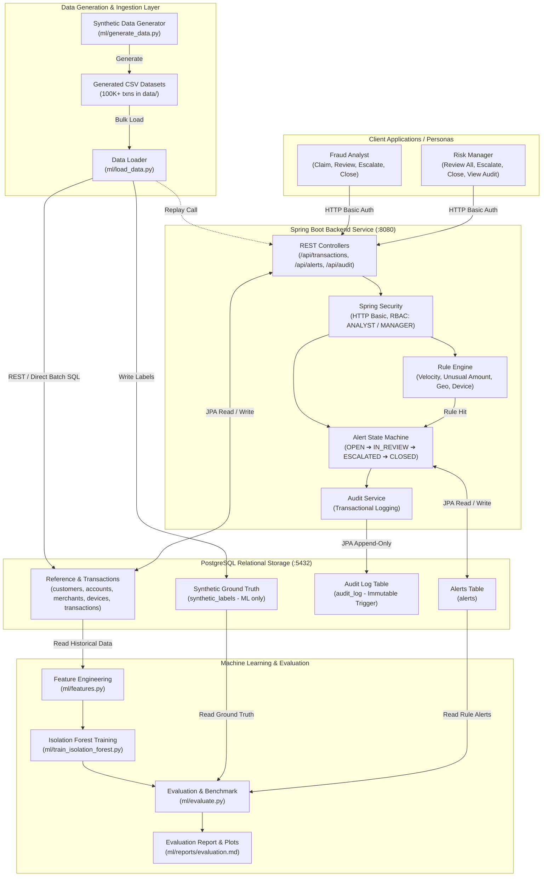

# Architecture & System Design

## 1. System Overview

The Transaction Risk Monitoring & Alerting System is architected as a modular, high-throughput micro-platform comprising:
- A high-performance **Spring Boot 3 REST Backend** executing real-time rule evaluations and stateful alert workflows.
- A **PostgreSQL 16** relational data store with optimized composite indexes and an immutable database-enforced audit trigger.
- A **Python 3.10/3.11 Machine Learning Pipeline** for offline feature extraction, unsupervised anomaly detection (Isolation Forest), and empirical benchmark reporting.
- **Client Personas** (Analyst and Manager) interacting with the system via authenticated REST endpoints and Swagger OpenAPI UI.

---

## 2. System Architecture Diagram

---

## 3. Component Details

### 3.1 Spring Boot REST Service
- **Framework:** Spring Boot 3.x on Java 17/21+.
- **Security:** HTTP Basic authentication utilizing `users` table credentials hashed with BCrypt. Role-based method authorization using `@PreAuthorize("hasRole('ANALYST')")` and `@PreAuthorize("hasRole('MANAGER')")`.
- **Transaction Processing:** Ingestion endpoints validate incoming transactions, persist records, and trigger synchronous rule execution.
- **Rule Engine:** Runs 4 independent rule implementations via composite pattern:
  - `VelocityRule`: Trailing transaction count within time sliding window.
  - `UnusualAmountRule`: Amount vs trailing 30-day moving average.
  - `GeoMismatchRule`: Country difference from customer origin or 1-hour temporal hops.
  - `NewDeviceRule`: Device ID novel to account with high-value transactions.
- **Workflow State Machine:** Enforces strict alert transitions:
  - $OPEN \rightarrow IN\_REVIEW$
  - $IN\_REVIEW \rightarrow ESCALATED$
  - $IN\_REVIEW \rightarrow CLOSED\_CONFIRMED \mid CLOSED\_FALSE\_POSITIVE$
  - $ESCALATED \rightarrow CLOSED\_CONFIRMED \mid CLOSED\_FALSE\_POSITIVE$ (Manager only)

### 3.2 Database Layer & Immutability Trigger
- **Schema Management:** Automated Flyway migrations (`V1__schema.sql`, `V2__audit_immutable.sql`, `V3__seed_users.sql`).
- **Immutable Audit Trail:** PostgreSQL trigger `audit_log_immutable_trigger` executes `BEFORE UPDATE OR DELETE ON audit_log` and raises an uncatchable SQL `RAISE EXCEPTION`, guaranteeing regulatory immutability against both application errors and DBA tampering.

### 3.3 Machine Learning Pipeline
- **Temporal Train/Test Split:** Historical window (first 70 days) used for training Isolation Forest; future window (remaining 20 days) reserved for unbiased out-of-time testing.
- **Zero Label Leakage:** Ground truth labels from `synthetic_labels` are never presented during feature extraction or model training.
- **Comparative Evaluation:** Benchmarks Rules-only, ML-only, and Hybrid ensembles across Precision, Recall, F1, and False Positive Rates.
